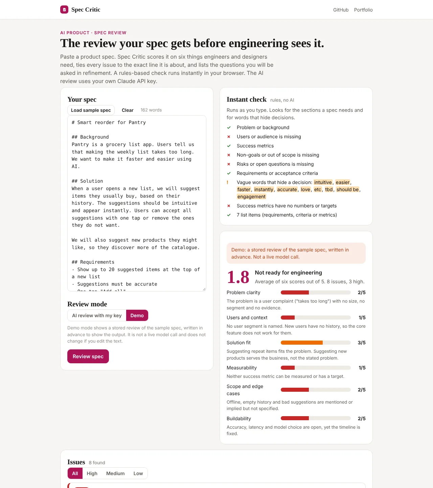

# Spec Critic

**An AI reviewer for product specs: scores, issues tied to exact lines, refinement questions and a rewritten problem statement.**

**Current version:** 0.2.0

Live: https://kostasxeras.com/spec-critic/



## The question

Specs reach refinement with the same gaps again and again: no measurable success metric, vague words like "intuitive", missing edge cases and a fixed date for an open technical question. A good engineering lead catches these in minutes, but not every PM has one on hand before the meeting. I wanted to see whether an AI reviewer could give that review in a form a PM can trust: every point tied to a real line, and nothing that looks like evidence when it is not.

## Who it is for

- Product managers who want a spec checked before refinement
- Junior PMs learning what a reviewable spec looks like
- Hiring managers looking at how I design an AI product with guardrails

## What is inside

- **Instant check** in plain JavaScript: required sections, vague words, numbers in success metrics, list items
- **AI review** through the Claude Messages API with the visitor's own key and a choice of model
- **Structured output**: six scores with reasons, issues with severity, section, exact quote, problem and fix, questions and a rewrite
- **Quote verification**: every quote from the model is checked against the spec and flagged if it is not found
- **Demo mode** with a stored, hand-written review of a sample spec, clearly labelled as not a live call
- **Issue filter** by severity and **copy as Markdown**
- **Key handling**: the key goes only to Anthropic's API and is kept in the tab only if the visitor asks

## Data and sources

No data is collected. The sample spec describes a fictional grocery list app. The demo review was written by hand for that sample and is labelled on the page.

## Decisions

- [The visitor's own API key, plus a demo](docs/decisions/0001-visitor-key.md)
- [Check every quote against the spec](docs/decisions/0002-verify-quotes.md)
- [A rules-based check that runs without AI](docs/decisions/0003-rules-before-ai.md)
- [A fixed JSON shape for the review](docs/decisions/0004-json-contract.md)

## How I would measure success

No usage data yet. These are the measures I would track, with targets to set after real use.

| Measure | Definition | Target |
|---|---|---|
| Reviews run | Live reviews per visitor with a key | [target] |
| Quote match rate | Share of model quotes found in the spec | [target] |
| Fix adoption | Share of issues the author says they fixed, once feedback is added | [target] |

## What I would do next

1. Test the live review with my own key on [number] real specs and report the quote match rate
2. Let users mark an issue as wrong, to measure precision
3. Compare scores before and after edits to the same spec

## My role

I framed the problem, made the product calls and wrote the conclusions. 

## Run it yourself

One HTML page with no build step. Open `index.html` through any local web server, for example `python3 -m http.server`, then go to http://localhost:8000.

## Repo layout

```
index.html               The page
app.css                  Shared base styles
docs/product-brief.md    Problem, users, goals, scope
docs/case-study.md       Approach, decisions, findings, next steps
docs/decisions/          One record per real tradeoff
docs/screenshots/        Desktop and mobile
```
